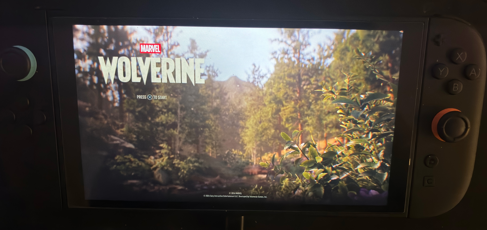

# Akira-ounce

 

This is still a work in progress, but It does boot and run well enough. I am still cleaning up the sub libraries before I release a build.

This is compiled with libounce, OunceVK, and other associated tools provided by ouncebrew and is meant to be used with the [ouncebrew](https://github.com/ouncebrew) project, primarily, KaiHEN.

This is still very early and experimental and I will most likely rewrite significant portions of it.

I have tested PS5 setup and stream directly.

**This is compatible with 90DNS, however, in order to be able to use it while 90DNS is active, In akira only, any getaddrinfo calls are wrapped to use a [custom resolver](https://github.com/chiaki-ng/akira-ounce/blob/master/source/util/custom_dns.cpp) via 1.1.1.1 and 8.8.8.8 for any [sony domains](https://github.com/chiaki-ng/akira-ounce/blob/master/include/util/custom_dns.hpp#L31-L40) only. This does NOT affect your systems 90DNS setup and is contained in the app**

Additional credits to the following individuals:

- [XITRIX](https://github.com/XITRIX) over from switch 1 moonlight who helped to test this on PS4
- [aveao](github.com/aveao) who was helping with getting my env to a testable state.

---

This software was built with reference/code from:

- [Streetpea](https://github.com/streetpea/chiaki-ng) the original chiaki-ng code
- [Pylux](https://github.com/ForWard-Technologies-LLC/Pylux) for the PS Cloud Streaming implementation
- [moonlight-switch](https://github.com/XITRIX/Moonlight-Switch) XITRIX's deko3d renderer for moonlight for the deko3d bits
- [switchfin](https://github.com/dragonflylee/switchfin/blob/bbcf9037fc3b11a78f5e0b7489d9e776fff2d99c/scripts/switch/mpv/deko3d.patch#L371) The patches used by dragonflylee in switchfin
- [wiliwili](https://github.com/xfangfang/wiliwili) WiliWili for how to get started with this new borealis api.
- [duckstation](https://github.com/RSDuck/duckstation) Duckstation's uam fork for runtime shader compilation

## Credits
- [PS5 icons by Zacksly, please support him here:](https://zacksly.itch.io/ps5-button-icons-and-controls)
- [Switch icons by zacksly, please support him here:](https://itch.io/queue/c/1334295/designs-by-zacksly?game_id=885118&password=)
- [Florian Grill (PXPlay dev](https://streamingdv.github.io/psplay/index.html) for the reverse engineering of the PS Remote Play API
- [Streetpea](https://github.com/streetpea/chiaki-ng) for chiaki-ng and your tireless effort in maintaining this library.
- [moonlight-switch](https://github.com/XITRIX/Moonlight-Switch) for the deko3d rendering code that I based it off with some changes 
- [thestr4ng3r](https://git.sr.ht/~thestr4ng3r/chiaki) for the original chiaki
- [devkitpro](https://github.com/devkitPro) for the associated homebrew packages
- [yellows8](https://github.com/devkitPro/curl/commits/libnx-backend/) for the work on the libnx backend which I used and updated for curl 8.18.0
- [xfangfang](https://github.com/xfangfang), [dragonflylee](https://github.com/dragonflylee), and [XITRIX](https://github.com/XITRIX) for all the work on borealis, moonlight, wiliwili, and switchfin which have made developing homebrew a much smoother experience due to all the examples avaliable.
- [kkwong](https://git.sr.ht/~kkwong/chiaki) for the initial hwacel and rumble patches
- H0neyBadger for the initial switch port, as well as all switch/chiaki contributors especially Egoistically and kkwong
- [QR Code generator](https://github.com/nayuki/QR-Code-generator) by Project Nayuki for the PS Store QR codes, vendored in.
- [micro-ecc](https://github.com/kmackay/micro-ecc) for the ECDH implementation that was vendored in.
- [vecteezy](https://www.vecteezy.com/vector-art/67445984-adorable-capybara-illustration-enjoying-a-drink) for the capybara logo.
